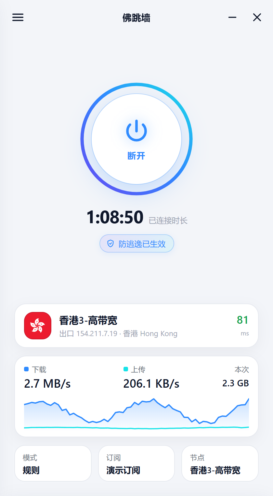
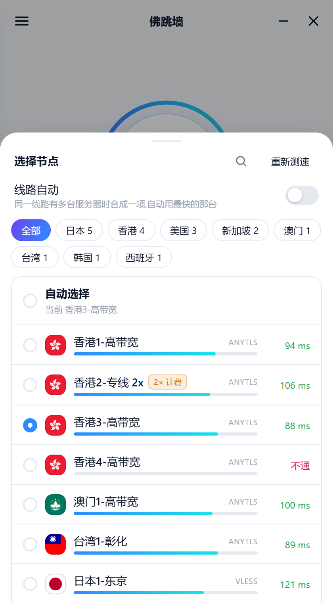
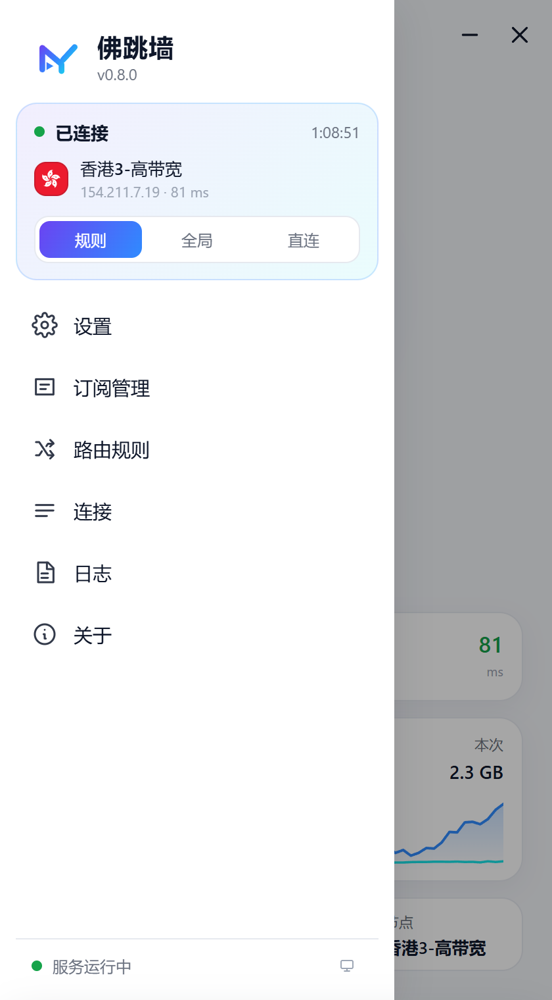

<p align="center"></p>
<h1 align="center">佛跳墙 · godusevpn</h1>
<p align="center">The client for the <a href="https://github.com/Maoyangui/m-ui">m-ui</a> panel · one interface on Windows / macOS / Linux / Android · embedded <a href="https://github.com/SagerNet/sing-box">sing-box</a> · TUN for the whole machine · IPv6 off by default</p>
<p align="center"><a href="README.md">中文</a> · <b>English</b> · <a href="https://maoyangui.github.io/godusevpn/">Website</a> · <a href="https://maoyangui.github.io/godusevpn/docs.html">Docs</a> · <a href="https://maoyangui.github.io/godusevpn/demo/">Live demo</a> · <a href="https://github.com/Maoyangui/godusevpn/releases">Download</a> · <a href="#defaults">Defaults</a></p>
<p align="center">
  <a href="https://github.com/Maoyangui/godusevpn/actions/workflows/build.yml"></a>
  <a href="https://github.com/Maoyangui/godusevpn/releases/latest"></a>
  <a href="LICENSE"></a>
</p>

---

**Want a look before installing?** The [live demo](https://maoyangui.github.io/godusevpn/demo/) is the client's own interface running on sample data: nothing to install and nothing it connects to, yet you can connect, switch nodes and modes and edit rules; a refresh resets it.

**No subscription yet and rather not run your own server?** [Get a ready-made subscription](https://godusevpn.org/subscription/) and just import it.

<p align="center">
  
  
  
</p>

The interface is in Chinese and English. The detailed wiki ([docs/wiki](docs/wiki)) is in Chinese.

## What it is

A multi-platform client for m-ui panels: embedded sing-box, TUN mode, Rule / Global / Direct, DoH + fake-ip, IPv6 off by default (IPv6 is pulled into the tunnel and rejected there, and the adapters' IPv6 protocol is turned off while connected), start at boot; several subscriptions (refreshes fall back from the current proxy to auto-select to direct), scheduled latency probes, visual rule groups, direct routing by process / app / device, in-app updates, log retention and diagnostics bundles. All four platforms share the same daemon and the same interface (one set of HTML / JS / CSS, light or dark following the system or set by hand).

| Platform | Status | Form |
|---|---|---|
| Windows 10 1809 or later / 11 (x64, ARM64) | Available | Background service + tray client (WebView2 window); installers under Releases |
| macOS 13 or later (Apple silicon, Intel) | Available | launchd service + .app window; double-click install from the package, or one curl line, no developer certificate needed |
| Linux desktop / server (systemd) | Available | A single binary with its own browser panel and a one-line installer |
| OpenWrt / iStoreOS and other soft routers | Available (gateway mode, verified in a container lab) | The same binary, procd autostart, ipk packages; per-device policies for the LAN |
| Asuswrt-Merlin (Entware) | In development | TProxy mode; no real device yet, feedback welcome |
| Android phones / TV | Beta (phones verified on real devices; TV fixed once from real-device feedback, retest pending) | The same pages in a WebView + a gomobile engine, VpnService for the tunnel, APKs split by ABI. The pages are written for old TV WebViews (Chrome 66 as the floor), guarded by `web/compat_test.go` |

## Layout

| Process | Runs as | Does |
|---|---|---|
| `godusevpn-svc.exe` | Windows service (SYSTEM, automatic start) | Core, subscriptions, config generation and dry-runs, TUN / routes / DNS, control pipe, diagnostics |
| `godusevpn.exe` | The signed-in user (starts at login) | Tray and main window (Wails + WebView2) |
| `godusevpn-cli.exe` | The current user | Troubleshooting and scripting: status, connect, mode, nodes, subscriptions, logs, diagnostics |

The service and the client talk over the named pipe `\\.\pipe\godusevpn`, one JSON per line; the service's access control lets normal users query, start and stop it, so "Quit" in the tray needs no elevation. Data lives in `%ProgramData%\godusevpn\`: `settings.json` (settings), `profiles\<id>.json` (cached subscriptions), `config.json` (the last generated config), `config.last-good.json` (the last config that started successfully), `cache.db` (fake-ip and node selection, deleted a dozen minutes after disconnecting), `rulesets\` (local rule sets), `logs\`, `diag\` (diagnostics bundles). The client's own preferences (language, appearance) are in `%APPDATA%\godusevpn\ui.json`.

## Building

The embedded sing-box needs these build tags:

```bash
go build -tags with_quic,with_utls,with_clash_api,with_gvisor -trimpath -ldflags "-s -w -X github.com/Maoyangui/godusevpn/internal/buildinfo.Version=0.3.0" ./cmd/godusevpn-svc
go build -trimpath -ldflags "-s -w" ./cmd/godusevpn-cli
go build -tags desktop,production -trimpath -ldflags "-s -w -H windowsgui" ./cmd/godusevpn
```

The macOS interface links against WebKit, so it needs CGO, plus the UniformTypeIdentifiers framework that Wails forgets to declare; the binary goes into a hand-assembled `.app` (template in `cmd/godusevpn/build/darwin/Info.plist`, the icns made on the spot with `sips` + `iconutil`):

```bash
CGO_ENABLED=1 CGO_LDFLAGS="-framework UniformTypeIdentifiers" go build -tags desktop,production -o godusevpn.app/Contents/MacOS/godusevpn ./cmd/godusevpn
```

Or just `powershell -File build.ps1`; the output goes to `dist\` (amd64 and arm64). Icons, manifests and version info are generated from `winres\*.json` by go-winres into each `cmd\*\rsrc_windows_*.syso`; CI regenerates them for every tag.

Icons: `go run ./tools/mkicons -logo cmd/godusevpn/build/logo.png -out cmd/godusevpn/build`. `logo.png` is the transparent original; the app icons get a white rounded backdrop (matching Android's adaptive icon) after the transparent margin is trimmed, plus an `appicon-macos.png` with a transparent border that becomes the Dock icon's icns; the tray icon stays transparent.

Tests: `go test -tags with_quic,with_utls,with_clash_api,with_gvisor ./...` (including sing-box dry-runs of generated configs, pipe round trips, every path of the state machine, and settings migrations).

## Install and use

Download from [Releases](https://github.com/Maoyangui/godusevpn/releases). Every asset is named `godusevpn-<version>-<os>-<arch>.<ext>`, packages for the same system sit together, and `SHA256SUMS` covers all of them:

| System | Package | Notes |
|---|---|---|
| Windows x64 | `godusevpn-<version>-windows-x64-setup.exe` | Standard; installs the WebView2 runtime online if it is missing |
| Windows x64 | `godusevpn-<version>-windows-x64-setup-offline.exe` | Offline full version with the WebView2 runtime inside, for trimmed systems and offline machines |
| Windows ARM64 | `godusevpn-<version>-windows-arm64-setup.exe` | ARM64 devices |
| Windows | `godusevpn-<version>-windows-<arch>-bin.zip` | The three bare exes, for manual replacement and troubleshooting |
| macOS | `godusevpn-<version>-macos-<arch>.tar.gz` | arm64 (Apple silicon) / amd64 (Intel): the daemon, `godusevpn.app`, `install.sh`, and for people who avoid the terminal an install guide plus double-click install / uninstall scripts |
| Linux | `godusevpn-<version>-linux-<arch>.tar.gz` | amd64 / arm64 / armv7 / mipsle / mips: the binary and `install.sh` |
| OpenWrt / iStoreOS | `godusevpn-<version>-openwrt-<arch>.ipk` | `opkg install` starts the service and prints the panel address |
| Android | `godusevpn-<version>-android-<ABI>.apk` | arm64 (almost every phone / TV), armv7 (old devices), x86_64 (emulators / a few boxes), universal (all in one) |

### Windows

**Requires Windows 10 1809 (build 17763) or later, x64 / ARM64**; the installer refuses older versions. Windows 7 / 8 are not supported and will not be: Go dropped them in 1.21 (the embedded sing-box needs a newer Go), and Microsoft no longer ships WebView2 for them.

The installer registers the background service (automatic start), installs the tray client and the command line, can turn on "start at login", and registers the `godusevpn://` protocol so landing pages can import with one tap (the client also re-checks the protocol on every start, so upgrades from old versions need no reinstall). The program is not signed; when SmartScreen warns, click "More info → Run anyway".

- **First start**: enter the subscription link from your panel to get in; without a subscription, use "Or add a node manually", or [get a subscription](https://godusevpn.org/subscription/).
> Regions are recognised from node names: flag emoji, Chinese and English place names and standalone two-letter country codes; anything unrecognised gets a globe and works the same. Flags are built-in SVGs (see web/dist/flags/) rather than the system emoji font — Windows still has no flag glyphs.

- **Home** has the big connect / disconnect button in the middle, with the connection time in large type once connected; below it two cards:
  - **Exit card**: region flag + current node + this line's real exit address with country and city + latency; tap it to switch nodes. The exit is looked up **through the current node**: a node's name says where its server is, not necessarily where traffic leaves (a node can chain another hop). It asks `ipwho.is` first (no key; one JSON with address / country / region / city / ISP) and falls back to Cloudflare's own `cdn-cgi/trace` (address and country code only, but almost always reachable); if both fail it shows "looking up exit" and retries on the next health check. Both endpoints answer with who they see, so the IP never has to be looked up anywhere else, and since the request goes through the tunnel they see the node's exit, not your address. It re-checks immediately after a node switch, after the core switches by itself under auto-select, and every 10 minutes.
  - **Speed card**: live upload and download, traffic for this connection, and the last minute's speed graph.
  At the bottom three tiles: mode (Rule / Global / Direct), subscription (tap to switch between several), node.
- **Node panel**: every row has a region flag and a latency bar; multipliers in names (`2x` / `x2` / `0.5倍`) are shown separately; a row of region tags on top filters the list, together with the search box. Latency tests only update the numbers without redrawing, so nothing flickers.
- **Line auto**: when the panel deploys a line on several servers (requires **m-ui 0.7.17 or later**, which puts such lines into subscriptions as line groups), a "Line auto" switch appears on top of the node panel. With it on, the servers of one line merge into a single entry; selecting it uses the fastest server of that line only (same line, same exit; "Auto" picks among all nodes and may change line); turning it off pins the server in use right now. Only that group's servers are tested; if the server in use fails (a connection fails, a health check fails) the group is tested on the spot and the client moves to a working server of the same line, usually within about twenty seconds (on real machines on 15 Nov 2026: about 20 s for a TCP line such as Reality; Hysteria2 / TUIC first have to wait for the session watchdog to declare the session dead, about 100 s). When a line drops to one server the client uses the one left and says so on Home, and returns to Line auto once the panel serves several again. The switch is hidden for older panels and for subscriptions without mergeable lines. Details (Chinese): wiki [日常使用](docs/wiki/日常使用.md).
- **IPv6-only nodes**: with "Allow IPv6" off (the default) they are not used on any platform — nodes whose address is written as IPv6, and nodes whose domain only has IPv6 addresses (only AAAA records; recognised while resolving node domains at connect time; under Global + Leak protection with the local DNS set to system or to a DoH given as a domain, that lookup is skipped, so such nodes are simply not flagged in advance). The node list marks them "IPv6 node" (so does the CLI's `nodes`); they stay out of auto-select and line groups and are not tested. You can still select one by hand but it will not connect: Home names the node and points to Settings → Privacy → "Allow IPv6", with status code `E_NODE_V6`. With "Allow IPv6" on but no IPv6 on the current network (no public IPv6 address on any adapter), such nodes cannot connect either: the list still marks them "IPv6 node", and when one is selected Home says that this network cannot reach it and that your connection is not down, with status code `E_NODE_V6_NET`; nothing in the configuration is changed, so it works again on a network with IPv6. With IPv6 off, the service's and the interface's own direct requests (fetching subscriptions while disconnected, update checks, installer downloads, rule-set downloads, DoH) use IPv4 only as well. Details (Chinese): [关于 IPv6](docs/wiki/关于%20IPv6.md).
- **Hint nodes**: the "nodes" panels put into subscriptions to show usage, expiry or renewal (m-ui's "00-勿选-流量…", an admin's own "renewal notice": address on the local machine with a port below 1024, or written as `0.0.0.0`) are marked "Hint", kept out of auto-select and line groups, and not tested — they used to sort first, auto-select landed on them until the first test finished, and under Global the whole machine had no network for those seconds. You can still select one by hand; Home then says it cannot reach the internet. socks / http nodes on the local address (pointing at another local proxy) and forwards on high local ports are treated as normal nodes.
- **First start** is a single onboarding page: just a subscription link, with a paste button next to it; below, a note that you can also use one-tap import on the landing page or add from a subscription QR code, and that the subscription URL is only stored on this machine.
- **Subscription QR codes**: no need to type the address. On desktop, **drop** the QR image from your panel's subscription page into the window (Home, Subscriptions and the onboarding page all accept it), **paste a screenshot**, or click the QR icon in the address field to choose an image; on Android phones tap "Scan a QR code" to use the camera, or "Photos" to pick a saved image. The code may hold the subscription URL itself or any of the usual import links (`godusevpn://import?url=…`, `clash://install-config?url=…`, `sing-box://import-remote-profile?url=…`, `sub://…`, `shadowrocket://add/sub://…`); a name carried in the link is filled in too. Light-on-dark codes and a small code inside a full-screen screenshot are recognised as well. A recognised code only **fills the form** — adding it is still your click; a node share link takes you to "Add a node manually", and anything else is reported as not being a subscription. Decoding happens on the device (bundled jsQR, see NOTICE); neither the image nor the camera picture is uploaded. TVs have none of these entries (no camera, and a remote cannot pick an image); use one-tap import or paste there.
- **Subscription URLs**: an address that is not in sing-box JSON format (the Clash address copied from an m-ui landing page, `?format=clash`, the browser address `?format=page`, or no `format` at all) is rewritten to `format=json` when fetching, so any of them works.
- **Subscriptions**: the current one is laid out as a large card — usage bar, used / total, node and region counts, expiry date — with three actions (refresh / edit / delete); the others are small cards, tap a row to switch, each with use / refresh / edit / delete. When the panel set a "buy / renew" address, the card gets a **Renew** button that opens the system browser; it turns orange with the days left when expiry is near or traffic is almost used up, and stays there even after expiry, even once the subscription itself can no longer be fetched (the panel sends the address along with that 404).
- **Add a node manually**: "Or add a node manually" under "Add subscription". Paste share links (vless, vmess, trojan, ss, hysteria2, tuic, anytls, socks, http; several at once; base64 and sing-box node JSON also work) and the form fills itself, or fill it in field by field; the form only shows the fields the protocol needs, with the rare ones under "More options". The core dry-runs it before saving and marks mistakes in place, so nothing broken gets stored. These nodes live in one "Manual nodes" entry and work in the node list, latency tests and rules as usual; they are only stored on this machine.
- **Connections**: three numbers on top (active / proxied / direct) and three filter tags; each row shows the target, the node used, protocol and duration, upload and download, and an × to close that one connection. The list **updates in place** every two seconds without flicker.
- **Logs**: black background, monospace, time / level / text in aligned columns, warnings and errors highlighted; show errors only, pause, copy all, and export a diagnostics bundle at the bottom. The core column filters by destination (tunnel / direct / blocked / DNS, with counts), each connection reads "destination · node + process → domain:port (IP)", so you see at a glance which program went where through which node; click a connection id to see every log line of that connection.
- **About** shows the version in the middle and lights the whole card up when there is a new version; below are service status and repair, core info, and three rows for the diagnostics bundle, the project page and quit.
- **Top-left menu**: a status card on top (connection state, time, current node and exit, the three modes switchable in place), then Settings, Subscriptions (add / edit / delete / refresh / renew), Routing rules, Connections (active connections and closing them), Logs (service and core, export diagnostics) and About (check for updates, repair service, quit); a small button at the bottom cycles through System / Light / Dark.
- **Routing rules**: a built-in default set (LAN and private ranges direct, Chinese domains and IPs direct, everything else proxied), each of the three adjustable (Direct / Proxy / Reject; "everything else" can only be Proxy or Direct), with "Restore defaults" to undo everything. You can add visual rule groups: name, outbound (Proxy / Direct / Reject / Auto / a specific node) and any number of conditions (domain suffix, full domain, keyword, regex, IP range, port, process name, geosite category, geoip country); any condition in a group counts as a match; groups are matched top to bottom before the defaults, only in Rule mode, and can be enabled, disabled, reordered, edited and deleted.
- **Refreshing a subscription does not drop connections**: additions and removals show up in the node list immediately while connections in use stay untouched; there is no "apply" step. Selecting a node that was just added (the core does not have it yet) or whose parameters changed rebuilds the config and reconnects once. Only if the node in use is removed or changed by the panel does the client reconnect by itself.
- **Leak protection** (on by default): as long as you are connected, traffic that should go through the tunnel may not leave through the local network — while the tunnel is not up yet, the core restarts, the node is down, the core is retrying after a crash, or the device reboots, it waits instead of leaking. **Global mode**: only the tunnel itself (node connections, the subscription-refresh fallback), loopback and, with "LAN bypass" on, the LAN are let through. **Rule mode**: the firewall follows the rules: IP ranges of the Direct rules (by default the LAN and Chinese IPs) go direct as usual, everything else waits; the firewall only knows IP ranges, so Direct rules written by domain, process or port wait for the tunnel, and a domain that a proxy rule sends to the tunnel but that resolves into an allowed range cannot be told apart. The rules are persistent: they survive the service being killed, crashing and reboots, and only disconnecting, switching to Direct, turning the switch off or uninstalling removes them, after which the system firewall is exactly as before (it is a separate set of rules and does not touch your own firewall). Windows uses persistent Windows Filtering Platform rules, macOS pf, Linux nftables; Android relies on the VPN interface staying up while the core restarts, and the system cannot allow traffic by rule, so in Rule mode direct traffic also waits while the tunnel is broken. To get the network back, the tray and the Start menu have "Restore network", see below.
- **Closing the window** only hides it to the tray and keeps the connection; "Quit" in the tray disconnects and stops the background service, and the TUN adapter goes away with it.
- **Subscription refresh fallback**: if refreshing through the current proxy fails, it retries a few times through the "Auto" group and then directly. The fallback only applies to that one refresh request; the selected node and the routing of other traffic are not affected.
- **Panel** (Linux): open to this machine and the LAN only by default; to open it from the internet set `webAllowPublic` yourself. The panel is plain HTTP, so on cloud servers an SSH tunnel is recommended.
- **Latency probe**: "Latency probe (minutes)" in the settings, 10 minutes by default. Under auto-select it really connects through every usable node once per period (skipping IPv6 and hint nodes) and switches to the fastest; with a line selected (Line auto) only that line's servers are tested; with a node picked by hand, in Direct mode or without traffic nothing is tested, and a hand-picked node never touches other nodes. Latencies in the node list measure the handshake from the adapter to the node (UDP-based nodes need one real connection); opening the list tests automatically at most once in five minutes. The interval is not part of the core config (the daemon schedules the tests), so switching between auto and manual or changing the interval takes effect in place without reconnecting.
- **Direct by process**: Settings → Routing, one exe name per line (e.g. `steam.exe`); those programs bypass the proxy. Under Global with Leak protection on this does not apply and they use the tunnel too; in Rule mode they go direct as usual, but wait for the tunnel when it is broken (the firewall cannot see processes).
- **Updates**: while connected the client checks for a new version through the node once an hour (it never checks while disconnected, so GitHub does not see your real IP; "Check for updates" under About works any time). A red **NEW** lights up next to the title on Home (and on About in the menu) — tap it to go straight to the update; or About → Check for updates → Update and restart. Only the program is replaced; settings and subscriptions stay. Old installers in the update folder are cleaned up: other versions before a new download, and the installed one and older after the new version starts.
- **Log retention**: 7 days by default; older rotated logs and diagnostics bundles are deleted automatically; change it under Settings → Logs, 0 keeps everything.
- **Connection targets stay off disk**: by default the target of each connection in the core log only lives in memory and is gone when the service restarts; the disk only holds masked warnings and errors. System logs do not record them either: macOS's launchd log, Linux's journald / logread and Merlin's crash log only get crashes and start-up failures, no connection targets (the core used to write every target to standard error, where the system log picked it up). For long-term troubleshooting turn on "Write core log to disk" under Settings → Logs. The fake-ip table (`cache.db`) is deleted a dozen minutes after disconnecting.
- **Exit lookup can be turned off**: the exit address on Home is looked up through the node at a third-party site after connecting; turn it off under Settings → Privacy if you do not want that.

## macOS

**Requires macOS 13 (Ventura) or later**; there is one package for Apple silicon and one for Intel (programs built with Go 1.27 start at 13). Two ways to install, both ask for your login (administrator) password once:

**Without the terminal**: download `godusevpn-<version>-macos-arm64.tar.gz` (Apple silicon) or `-amd64` (Intel) from [Releases](https://github.com/Maoyangui/godusevpn/releases/latest), double-click to unpack, and follow the install guide in the folder: double-click the install script and type your login password in the terminal that opens (allow access to the Downloads folder when asked). Files downloaded by a browser carry a quarantine flag, so macOS blocks the script once — on macOS 13 / 14 right-click → "Open", from macOS 15 on go to System Settings → Privacy & Security and click "Open Anyway"; once allowed it clears the flag for the whole folder, so the installed client is never blocked again. A package for the wrong chip tells you which one to download.

**With the terminal** (never blocked, nothing to allow):

```bash
curl -fsSL https://raw.githubusercontent.com/Maoyangui/godusevpn/master/deploy/macos-install.sh | sudo sh
```

If you already unpacked the package, `sudo sh install.sh` in that folder works too.

**Why the curl line is not blocked**: Gatekeeper's "downloaded from the internet" quarantine flag is set by browsers; files fetched with curl do not have it, so there is no need to buy an Apple developer certificate or to allow anything under System Settings → Privacy & Security. If you already downloaded the package with a browser, `install.sh` clears the flag along the way.

You end up with two things: `/usr/local/bin/godusevpn` is the daemon and the command line, registered as a launchd service (`/Library/LaunchDaemons/com.maoyangui.godusevpn.plist`) that starts at boot; `/Applications/godusevpn.app` is the interface, called "佛跳墙" in Launchpad, with the same pages as Windows / Linux.

- Data lives in `/Library/Application Support/godusevpn/` (settings, cached subscriptions, `config.json`, logs, diagnostics); interface preferences in `~/Library/Application Support/godusevpn/ui.json`.
- The tunnel adapter is the system-assigned `utunN` (macOS only accepts that name) and **the stack is fixed to gvisor** — the system stack cannot complete handshakes on macOS (the kernel never receives inbound TCP), so the settings only offer gvisor.
- **DNS is taken over**: on connect every network service's DNS is set to an address inside the tunnel and restored to the previous values on disconnect (the daemon also restores it when it starts, so even a crash does not leave a machine that cannot open pages — unless it was connected in strict Global mode last time: then the takeover stays until the guard and the tunnel are rebuilt, otherwise lookups in those tens of seconds would go out through the physical adapter). Without this macOS keeps asking the router (192.168.x.1), and since private ranges are outside the tunnel under "LAN bypass", lookups would leak to the local network and fake-ip and AAAA blocking would stop working.
- This version has **no menu-bar icon**: Wails and systray both want the Cocoa main thread, and putting them together needs an external event loop that cannot be tuned without a real Mac at hand. Closing the window only closes the interface; the tunnel keeps running in the background service, and opening the app from Launchpad brings it back.
- One-tap import: the `.app`'s Info.plist registers `godusevpn://` with the system, so a landing page hands the subscription to the client directly.
- Updates: About → Check for updates → Update and restart; the system asks for the administrator password once and the daemon and the `.app` are replaced together.
- Uninstall: double-click the uninstall script from the package; or `sudo godusevpn uninstall` to remove the service, then delete `/Applications/godusevpn.app` and `/usr/local/bin/godusevpn`.
- Acceptance: `sudo sh deploy/macos-test.sh <subscription URL>`, 53 checks; CI runs it for real on GitHub's Apple-silicon runners for every commit (install the service, fetch the subscription, build the tunnel, push traffic through the rules, check that IPv6 is really blocked without bypassing the tunnel, call each page's API), installs the `.app` into `/Applications` and opens it to see that it stays alive, and runs the double-click install / uninstall on a package carrying the browser quarantine flag (the installed program must not keep the flag).

## Linux (desktop distributions / soft routers)

The same daemon and pages run on Linux: one static binary `godusevpn` is both the service and the command line and serves its own browser panel (plain HTTP). As root:

```bash
curl -fsSL https://raw.githubusercontent.com/Maoyangui/godusevpn/master/deploy/install.sh | sh
```

When it finishes the terminal prints the panel addresses (LAN / private address, the public address on cloud servers, the local address) and a randomly generated initial password. On Linux the panel listens on `0.0.0.0:9800` by default, so other devices on the LAN can open it directly; on cloud servers allow TCP 9800 in the security group / firewall. Change the password with `godusevpn passwd`; to keep it local only, `godusevpn settings webListen=127.0.0.1:9800`. The panel is the same set of pages as the Windows client with the same features (subscriptions, the three modes, rule groups, latency tests, logs, updates).

- The data layout matches Windows: settings in `/etc/godusevpn/`, caches, rule sets and logs in `/var/lib/godusevpn/` (under `/opt/etc` and `/opt/var/lib` on Merlin and other Entware systems).
- Autostart follows the init system: a systemd unit, an OpenWrt procd script, an Entware init.d script; `godusevpn install | uninstall | start | stop | status`.
- Local mode (default): TUN proxies only this machine's traffic, as on Windows; connections coming in from outside (SSH, the panel) are recognised by connection tracking and answered through the original route, so remote SSH is not cut off; programs that bind to the physical adapter's address (WebRTC) still go through the tunnel.
- Gateway mode (OpenWrt / iStoreOS soft routers): Settings → Network → Network mode → Gateway (or `godusevpn settings netMode=gateway`); LAN devices that use this machine as gateway and DNS are proxied, and their DNS queries are handled by the core (fake-ip, no leaks). The menu gains a Devices page: online devices are found automatically (DHCP leases + neighbour table), and each can follow the rules / always proxy / go direct / be blocked, remembered and applied by MAC (an IP change needs no core restart, an old IP handed to someone else does not inherit the policy, IPv6 addresses count too); command line `godusevpn devices`, `godusevpn device <MAC> <follow|proxy|direct|reject> [name]`. A single-port side router works as well; on plain Linux IP forwarding is turned on while connected and back off afterwards. The kernel needs nftables (fw4 on OpenWrt 22.03 and later has it). Under Global with Leak protection on, a device's "Direct" does not apply and it still uses the tunnel.
- Acceptance script `deploy/linux-test.sh`, with the same checks as Windows; gateway mode was verified in Docker on OpenWrt 23.05, Ubuntu with two ports and Ubuntu as a single-port side router (devices proxied, fake-ip, IPv6 blocked, the three device policies, policies following a device's IP change).

## Android (phone / TV)

Beta: phones work on real devices (connect, routing, disconnect, updates); the TV build has only been verified in an emulator so far. Feedback welcome.

- **Install**: sideload `godusevpn-<version>-android-<ABI>.apk` (phones and TVs are almost all arm64; if unsure take universal); the first install needs "unknown sources" allowed. Android 8.0 or later.
- **Same interface and features**: the daemon (settings, several subscriptions with the refresh fallback, rule groups, state machine, scheduled tests) and the pages are the same code as on Windows / Linux, with the same data layout (`settings.json`, `profiles/`, `config.json`, `logs/`), just inside the app's private directory.
- **Tunnel**: the first "Connect" shows the system's VPN permission prompt; after that VpnService builds the tunnel from the engine's parameters (addresses, routes, DNS, per-app direct), with a persistent notification that has a "Disconnect" button. The app itself is **not** excluded from the tunnel (if it were, replies to its own sockets would leak out of the physical adapter; on a real phone DNS worked and all TCP broke); the core's own sockets to the nodes are protected and stay out of the VPN.
- **Direct by app**: Windows's "Direct by process" is the app package name on Android (Settings → Routing); those apps bypass the VPN entirely. Under Global with Leak protection on this does not apply and they use the VPN too.
- **Start at boot**: the engine reconnects according to the last state; Android 12 restricts starting foreground services from the background, so the service is brought up within the boot and update-finished broadcast window. You can also set it as the "Always-on VPN" in the system settings.
- **Updates**: About → Check for updates downloads the APK for your ABI, checks its SHA256 and opens the system installer; afterwards the engine reconnects according to the last state. Every version is signed with the same key, otherwise the system would not allow installing over it.
- **Add by scanning**: on the onboarding page and under Subscriptions you can scan the QR code on your panel's subscription page with the camera, or pick an image from Photos. The camera permission is only requested when you tap scan and only used while the viewfinder is open — recognising a code, closing it, pressing Back or leaving the app all release the camera. Declining the permission affects nothing else; use "Photos" instead (it goes through the system picker, so the app cannot see your other photos).
- **TV**: the same package runs in landscape on Android TV / boxes, with focus moved by the remote's arrow keys; pasting the subscription link from the clipboard is recommended.
- **Diagnostics**: Logs → Export diagnostics, then share it through the system.

Build: `deploy\android-build.ps1` (gomobile bind to an AAR → Gradle to APKs; needs JDK 17 and the Android SDK / NDK); emulator smoke test `deploy/android-emu-test.sh <subscription URL>`.

## Command line (troubleshooting)

As administrator:

```
godusevpn-svc install                          register and start the service
godusevpn-cli profile https://panel/sub/user    set the subscription (format=json is added automatically)
godusevpn-cli connect
godusevpn-cli status
godusevpn-cli mode global | rule | direct
godusevpn-cli nodes / select <node> / test
godusevpn-cli settings ipv6=on tunStack=system probeMinutes=5 logDays=14
godusevpn-cli rules                            list rule groups
godusevpn-cli logs 200 core
godusevpn-cli diag                             print diagnostics (subscription URL, credentials and connection targets masked)
godusevpn-svc uninstall
```

## Defaults

**Privacy settings that are on out of the box**: Leak protection (`noDirect`), IPv6 off (`ipv6` off), turning off IPv6 on adapters while connected (`disableNicIpv6`), TUN for the whole machine with strict routing, fake-ip; the core log is not fully written to disk (`coreLogDisk` off) and the panel is not open to the internet (`webAllowPublic` off). When upgrading from older versions, settings missing from the file are filled in with these values — "Turn off IPv6 on adapters" and Leak protection were added later and are migrated as on; anything you turned off yourself is not turned back on. Tests in `internal/settings` pin these values: changing a default, or a migration that flips one, fails them.

- TUN: `auto_route` + `strict_route`, mixed stack (fixed to gvisor on macOS, where the system stack cannot complete handshakes), private ranges bypassed; desktop platforms also open a mixed port on 127.0.0.1:2080 (not on Android: it is of no use there, and if the port were taken the core could not start).
- DNS: remote DoH 1.1.1.1 through the proxy, local DoH 223.5.5.5 direct, Chinese domains (in Rule mode while the default "China" rule is Direct) and node domains resolved locally; fake-ip only hands out IPv4; port 53 and the DNS protocol are always captured by the core. While connected, the system's DNS cannot go around the tunnel to the router: macOS's system DNS is taken over, Linux uses policy routing to pull packets to port 53 into the tunnel (whatever their destination, LAN addresses included), and the core asks the router on its behalf for LAN names like nas.lan and short names. On Linux, queries systemd-resolved sends bound to a physical adapter (names with that adapter's search domain) also go through the tunnel while Leak protection is on.
- IPv6: off by default and blocked at four layers at once: DNS `ipv4_only`, no IPv6 fake-ip range, every IPv6 destination rejected; and TUN still declares an IPv6 address so v6 traffic is pulled into the tunnel and dropped there — otherwise it would go around the tunnel straight out of the physical adapter, which is a leak (the LAN's `fc00::/7`, `fe80::/10` and `ff00::/8` stay outside the tunnel).
- **Turning off IPv6 on adapters** (Settings → Connection → "Turn off IPv6 on adapters", on by default): the four layers above stop IPv6 *packets* from leaving; they cannot stop a program from *reading the adapter configuration*. The public IPv6 address your ISP hands out by router advertisement sits on the physical adapter, and a native program (not a web page — browser sandboxes do not expose it) can enumerate the adapters, read it and report it through the tunnel to its own server — no packet leaked, but the information did, and that prefix maps to one specific broadband line. So while connected the IPv6 protocol is turned off on the adapters as well, and the address simply does not exist: Windows disables the `ms_tcpip6` binding (the same as unticking "Internet Protocol Version 6" in the adapter properties), Linux writes `net.ipv6.conf.<adapter>.disable_ipv6=1`, macOS turns it off per network service with `networksetup -setv6off`. The tunnel's own adapter is left alone — it needs its v6 address to pull v6 in and reject it.
  Each adapter's state is saved before it is changed and restored on disconnect; the daemon reconciles once at start: if the machine was not shut down while connected it restores, if it was it keeps IPv6 off — like the Leak protection guard it is persistent, and when the connection state cannot be read it goes by whether the guard is still there; adapters that were already off are recorded but not touched, and not turned on when restoring (you turned them off yourself). **It is also turned off in a soft router's gateway mode**, which is exactly where you want the whole LAN to have no v6 way out; turn the switch off to keep IPv6 on the LAN. **Not possible on Android**: apps cannot change the physical adapter's IPv6 configuration, so there is only the "pull into the VPN and reject" layer, and the settings do not show this switch.
- Modes: the routing rules have three built-in branches, switched through the core's Clash API in milliseconds without a restart.
- Rule sets: `geosite-cn`, `geoip-cn` and `geosite-category-ads-all` **ship with the installer** (usable right after installing; the core does not go online to start). Other geosite / geoip categories used by rule groups are downloaded by the daemon after connecting and take effect on the next connection; a rule set missing locally is removed from the config together with the rules that use it, instead of letting the core download it — remote rule sets are a synchronous start-up dependency, and failing to fetch one would keep the whole core from starting. Lookup order: `rulesets\<tag>.srs` (your own) → `rulesets\downloaded\` → `rulesets\builtin\`.
- User rule groups: each group becomes one routing rule (several kinds of conditions combined with logical/or), placed after the clash_mode branches and before the built-in China-direct rules; if the outbound is a node that is not in the current subscription it falls back to proxy.

### Leak protection

The switch is under Settings → Privacy, on by default. It applies when three things hold at once: the switch is on, the mode is Global, and you have not clicked Disconnect. Then nothing except the tunnel itself (node connections, the subscription-refresh fallback, the one DNS lookup for node domains), loopback and, with "LAN bypass" on, the LAN may go around the tunnel (DNS excepted: on Windows and macOS DNS queries to any address may only use the tunnel, and are not sent to the router even in the gap while the tunnel is down; Linux, see the table) — while the tunnel is not up yet, the core restarts (changing subscription, switching auto / manual), the node is down or the core is backing off after a crash, everything waits.

**The guard is persistent**: it does not live with the service process — if the service is killed, crashes, is replaced during an update, or the machine reboots, the guard stays (on Windows it is written into the Windows Filtering Platform's persistent store, with a separate set of boot-time filters covering the seconds between boot and the firewall engine starting; on macOS / Linux the rules live in the kernel and are gone after a reboot, so while the guard is on a boot copy is saved and installed early at boot by a separate boot unit — on Linux (systemd, OpenWrt) before networking; on macOS launchd starts it at boot, which is not guaranteed to be before networking but keeps the gap as short as possible; on Merlin (Entware) `/opt` is mounted after networking, so this cannot be done and there is no guard for the few seconds between boot and the daemon starting). Only four things remove it: Disconnect, switching to Rule / Direct mode, turning the switch off, uninstalling. Every time the service starts it reconciles first: if it was shut down disconnected, leftovers are cleared; what should be there is installed right away.

| Platform | How | Limits |
|---|---|---|
| Windows | A set of persistent rules in the Windows Filtering Platform (WFP): permit this service's process (besides the exe path, the process must run as LocalSystem or as an elevated administrator; the same exe started under another account is not permitted), the tunnel addresses and loopback; block DNS (53 / 853), UPnP discovery / NAT-PMP / PCP (UDP 1900, 5351, 5350) and the v6 fake range, all above the LAN permits; permit the LAN, DHCP, neighbour discovery, and the packets this machine needs as DHCP server and DNS proxy while sharing a hotspot (even with "LAN bypass" off, LAN-only); block the rest (at runtime these blocks carry the "veto" flag, so other software's permits cannot override them); plus boot-time rules (tunnel addresses, LAN, loopback, DHCP, neighbour discovery, no processes) from boot until BFE is up. **The forwarding layer is guarded too**: with a hotspot / Internet Connection Sharing, forwarded traffic may only go into the tunnel interface, and to the LAN only with "LAN bypass" on (as with the Linux gateway mode's forward chain); if the tunnel interface cannot be found everything is blocked until the daemon's next sync or the half-minute check adds the permit; with TUN off (mixed port only) the forwarding layer has no interface to permit, so hotspot devices lose network, by design | Needs the BFE (Base Filtering Engine) service; if it is stopped Home shows the guard as not in effect; the service depends on it, so the boot order is right |
| macOS | The pf anchor `com.apple/godusevpn`: permit root (the daemon) and the tunnel addresses, block DNS (53 / 853) and UPnP discovery / NAT-PMP (UDP 1900 / 5351), permit the LAN, DHCP broadcasts and neighbour discovery, block the rest. Every install checks that pf is really enabled; if another program turned pf off it reports "not enabled" truthfully and reinstalls | pf can only permit by user, not by process: the daemon must be root to manage utun / routes / pf and the core runs inside it, so other processes running as root are permitted too |
| Linux | The nftables table `inet godusevpn_guard`: permit this service by mark (core outbound connections carry `route.default_mark`; the subscription fallback and DoH use the same mark); for root, only packets answering inbound connections (sshd, the panel); block DNS (53 / 853) and UPnP discovery / NAT-PMP (UDP 1900 / 5351), permit the LAN, DHCP and neighbour discovery, block the rest. DNS is first pulled into the tunnel by policy routing (packets to port 53 use a table that only has "default via tunnel"), so systems whose `resolv.conf` points straight at the router still resolve while connected and are blocked in the gap. The forward chain applies in both gateway and local mode: Docker, VM NAT and hotspot sharing forwarded through this machine may only use the tunnel too | Without port-based policy routing in the kernel (before 4.17) DNS cannot be pulled into the tunnel, so the guard does not block DNS and Home warns about it |
| Android | The VPN interface is not closed while the core restarts, so the interface itself is the guard (packets falling into it are dropped); only Disconnect closes it | If the process is killed the VPN interface goes away; an app cannot guard across processes by itself: the settings link to the system VPN settings, where you set godusevpn to "Always-on VPN" + "Block connections without VPN", which also covers reboots |

Under Global + Leak protection, UPnP discovery / NAT-PMP are blocked even towards the LAN (not in Rule mode) (local programs can use them to ask the router for your broadband's real public address); the cost is that casting to LAN devices and automatic device discovery do not work then, while entering an address by hand still does.

**Bridged VMs / containers are outside the guard**: VMware / VirtualBox bridged adapters, a Hyper-V external switch, a Linux br0 bridge act like another machine on the LAN; their packets leave the physical adapter at layer 2 without passing this machine's network stack, so the guard cannot see them, and turning off adapter IPv6 does not reach them either. To send them through the tunnel use NAT mode instead (NAT-mode VMs, WSL2 and Docker's default network are forwarded through this machine, where the guard applies).

**Restore network** (for when the service will not start, the guard is still on and the machine has no network): four ways, none needs the service alive. **When the guard really is on**, they first turn the Leak protection switch off — otherwise the service would find on its next reconnect that the guard is gone and put it back, and your restored network would drop again seconds later; turn it back on under Settings → Privacy. If the guard was not on (say you are in Rule mode and only want the adapters' IPv6 back), neither switch is touched:

1. The tray menu "Restore network";
2. Start menu → 佛跳墙 → "Restore network" (asks for UAC, then shows a box with the result);
3. Command line: Windows `"C:\Program Files\godusevpn\godusevpn-svc.exe" guard clear` (asks for UAC), macOS / Linux `sudo godusevpn guard clear`; `guard status` shows whether the guard is on;
4. The uninstaller removes the guard before deleting files.

**A few more things while the guard is on**:

- The one lookup for node domains no longer asks the router / ISP in plain text: it uses the "local DNS" DoH server (connected by address, so nothing else has to be resolved first); with "local DNS" set to system, the core's resolver for node domains switches to the DoH at 223.5.5.5 and the pre-resolution before the tunnel is up is skipped (nodes still match domain rules); if the DoH server itself is given as a domain, that domain is also resolved through the same encrypted DoH and the pre-resolution is skipped too. Rule / Direct modes are unchanged — they never promised no direct traffic.
- No direct latency tests before the tunnel is up: "Test again" in the node list asks you to wait for the tunnel instead of letting the test packets hit the guard.
- A failed guard removal never pretends to be disconnected: the state shows "Guard removal failed" with the reason and the shield on Home stays lit. If the filters are all gone and only the clean-up did not finish, that is not a failure and only goes to the log.

**Before going back to an older version, click Disconnect in this one** (the guard is removed together with the forwarding layer), then install the old one: this version adds filters at the forwarding layer of the Windows Filtering Platform that the guard removal and uninstaller of 0.6.24 and earlier do not know, so swapping the old files in by hand while connected leaves them behind — hotspot / Internet Connection Sharing would stay broken until you reinstall this version and remove the guard.

**Do not delete the program folder by hand**: the rules live in the system and nobody can remove them once the program is gone — if it comes to that, on Windows install again and uninstall; on macOS / Linux run `sudo pfctl -a com.apple/godusevpn -F all` / `sudo nft delete table inet godusevpn_guard`.

### Tunnel self-healing (session watchdog)

A hysteria2 / TUIC outbound is one long session, and web requests are streams inside it. After switching networks, waking from sleep or a router restart, a common state is a session that is still "alive" at the QUIC layer (the other side never closed it) yet delivers nothing — the core does not tear it down by itself, so every request hangs until its timeout, and Leak protection lets nothing go around it: the whole machine has no network, while other devices on the same node work fine.

The daemon wraps these two outbounds in a watchdog:

- **Declaring it dead**: a stream that fails to read or write within the handshake window (20 seconds), or that the application gives up on without receiving a single byte (closed after surviving the handshake window), counts as one failure; 5 failures within 40 seconds with no stream receiving any data in the last 20 seconds declare the session dead, and the core's outbound is told to tear it down and rebuild (the same path as "the network changed"), at most once in 45 seconds. Errors on streams that did receive data do not count — they prove the session is alive; neither do clear answers from the server that the target is unreachable, or streams it resets, which equally show the session is alive, so opening a few unreachable sites in a row does not kill the tunnel.
- **Warming up after a rebuild**: if the node is in use and you still want to be connected, a new handshake with the same node starts in the background right after the teardown (on failure it retries after 1 and 2 seconds, at most 3 times), instead of waiting for the next request.
- **Immediate health check**: declaring it dead also kicks the state machine into a health check instead of waiting for the three-minute timer; after the first failure the rhythm tightens, so confirming that something is really wrong only takes another short period.
- **Boundaries**: everything stays inside the tunnel — it only re-handshakes with the same node, never switches nodes, never opens any direct connection, and never touches the guard or the adapters. Switching nodes still only happens in two ways: you pick one, or the state machine reaches "temporary line switch".

The `state` in a diagnostics bundle has a `tunnel` section (`rebuilds`, `sick` count, and `lastAt` / `lastNode` / `lastReason` for the latest one), counted for the node in use only; `godusevpn status` shows "tunnel: declared dead N times, rebuilt N times". When the network is gone, look here first: a growing count means the session keeps breaking and the watchdog keeps fixing it; if it never grows while pages still do not open, the problem is not at this layer. On Android this layer only declares sessions dead and tears them down; warming up and immediate health checks are desktop / router only for now.

## Community

Telegram: [@yangweii](https://t.me/yangweii) · group: [t.me/godusevpncn](https://t.me/godusevpncn). Questions and suggestions are also welcome as [issues](https://github.com/Maoyangui/godusevpn/issues).

## License

GPL-3.0, the same as the embedded sing-box.

Third-party material and its licenses are listed in [NOTICE](NOTICE): the embedded sing-box (GPL-3.0) and the region flags in the node list (flag-icons, MIT).
